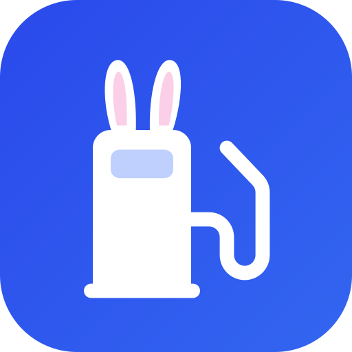
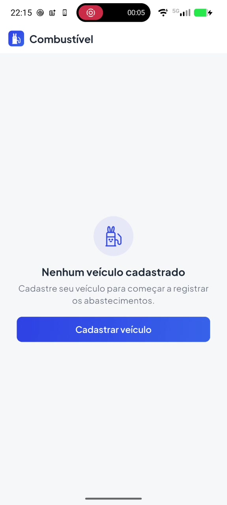
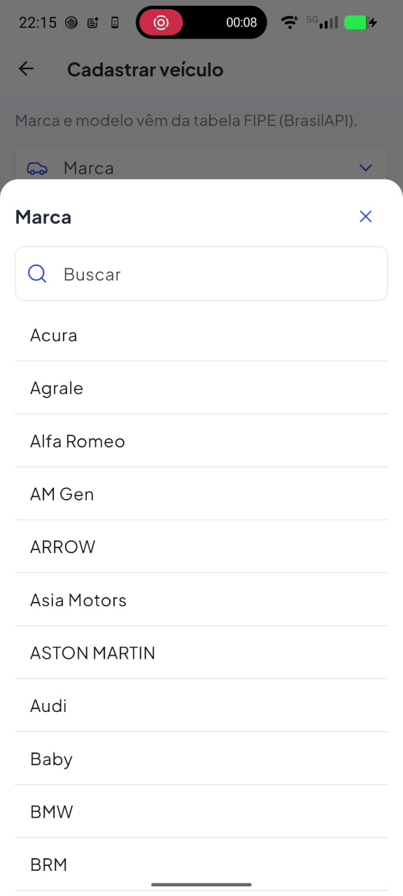
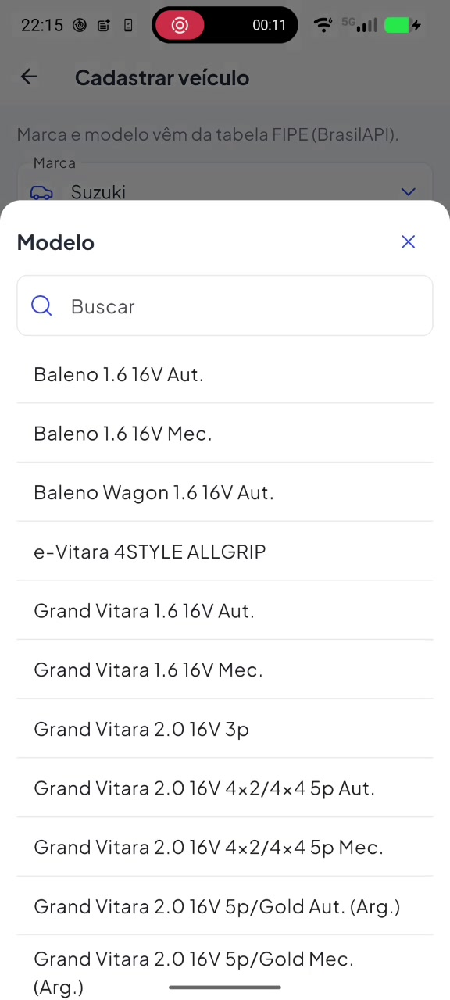
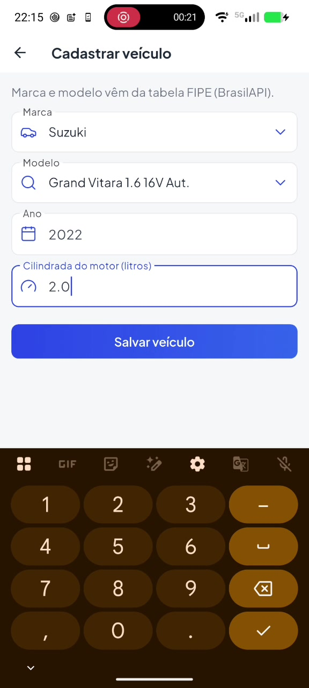
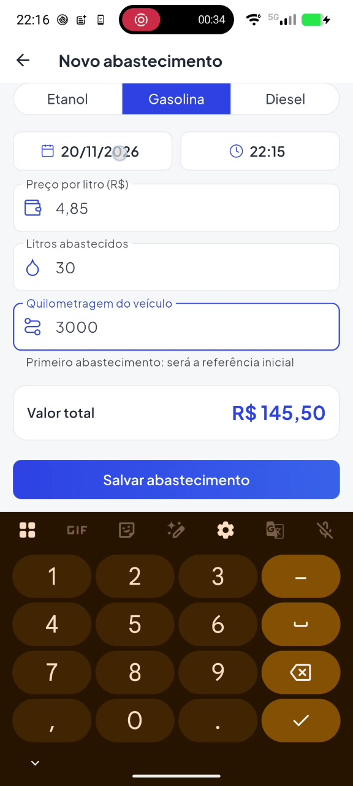
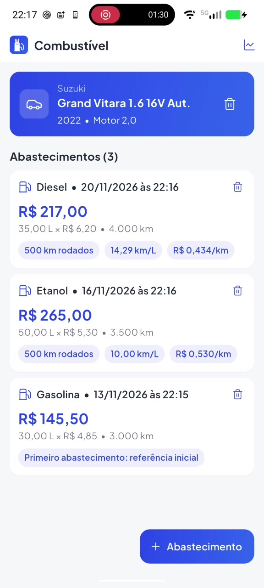
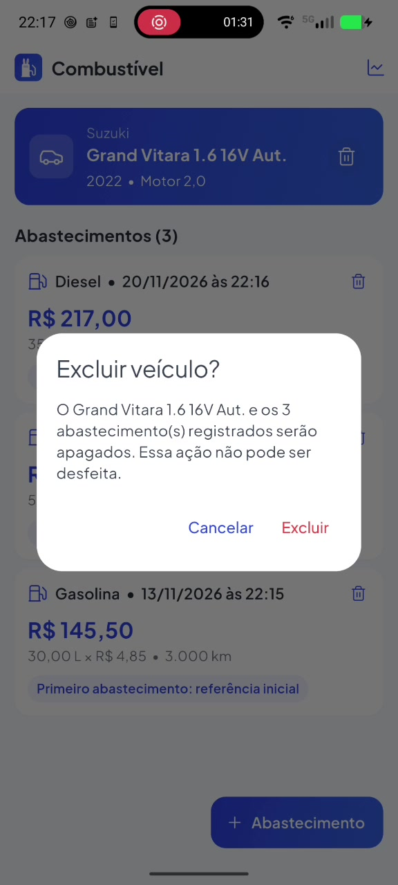
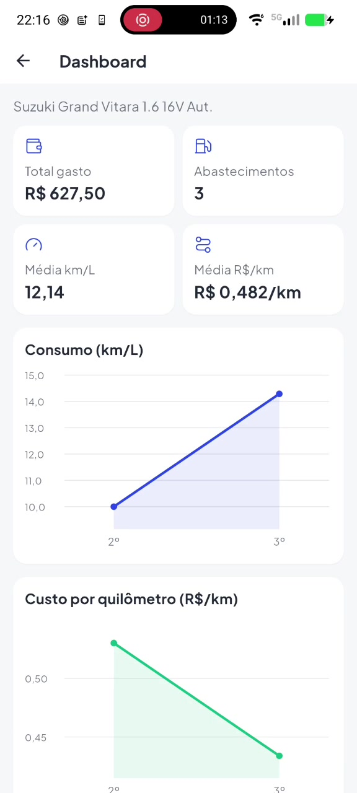
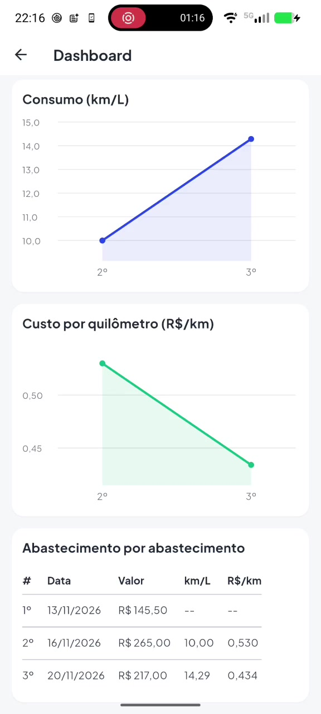

# Combustível

Atividade Substitutiva da Prova 1 da disciplina Programação para Dispositivos Móveis I (Prof. Arley, FATEC).

App Flutter para Android que registra os abastecimentos de um veículo e acompanha os gastos com combustível e o consumo ao longo do tempo. Marca e modelo vêm da tabela FIPE pela BrasilAPI, os dados ficam salvos no celular e o dashboard mostra a evolução do consumo e do custo por quilômetro em gráficos.


<details>
<summary><strong>Telas e funcionalidades</strong></summary>

<br>

**Início**

- Sem veículo cadastrado, mostra o aviso e o botão para cadastrar.
- Com veículo, mostra o cartão com marca, modelo, ano e cilindrada, e a lista de abastecimentos do mais recente para o mais antigo.
- Cada abastecimento mostra combustível, data e horário, valor total, litros, preço por litro e quilometragem, e, a partir do segundo, distância percorrida, km/L e R$/km.
- Exclusão de um abastecimento, com confirmação.

**Cadastro do veículo**

- Marca escolhida numa lista com busca, carregada da BrasilAPI.
- Modelo carregado depois da escolha da marca, só com os modelos dela.
- Ano (entre 1950 e o ano seguinte ao atual) e cilindrada do motor em litros.
- Só um veículo por vez. Para cadastrar outro, é preciso excluir o atual, e a exclusão pede confirmação e apaga também os abastecimentos dele.

**Novo abastecimento**

- Tipo de combustível (etanol, gasolina ou diesel), data e horário, preço por litro, litros abastecidos e quilometragem.
- Valor total calculado na hora (preço por litro × litros).
- A quilometragem precisa ser maior que a do abastecimento anterior e menor que a do seguinte, considerando a data escolhida.
- Data e horário não podem estar no futuro.

**Dashboard**

- Total gasto, quantidade de abastecimentos, média de km/L e média de R$/km.
- Gráfico de linha do consumo (km/L) e do custo por quilômetro (R$/km), abastecimento a abastecimento, com o valor de cada ponto ao tocar nele.
- Tabela com o valor, o km/L e o R$/km de cada abastecimento.

</details>

<details>
<summary><strong>Como os indicadores são calculados</strong></summary>

<br>

Todos os registros são considerados abastecimentos que completam o tanque. O primeiro serve como referência inicial e não tem km/L nem R$/km. A partir do segundo:

| Indicador | Cálculo |
| --- | --- |
| Valor do abastecimento | preço por litro × litros |
| Distância percorrida | quilometragem atual − quilometragem do abastecimento anterior |
| Consumo (km/L) | distância percorrida ÷ litros do abastecimento atual |
| Custo (R$/km) | valor total do abastecimento atual ÷ distância percorrida |

Os abastecimentos são ordenados pela data e horário antes do cálculo.

</details>

<details>
<summary><strong>Capturas de tela</strong></summary>

<br>

| Ícone | Sem veículo | Marca | Modelo |
| :---: | :---: | :---: | :---: |
|  |  |  |  |

| Cadastro do veículo | Novo abastecimento | Abastecimentos | Excluir veículo |
| :---: | :---: | :---: | :---: |
|  |  |  |  |

| Dashboard | Gráficos e tabela |
| :---: | :---: |
|  |  |

</details>

<details>
<summary><strong>Persistência local</strong></summary>

<br>

Banco SQLite `combustivel.db`, com duas tabelas:

**veiculos**

| Coluna | Tipo | Observação |
| --- | --- | --- |
| id | INTEGER | Chave primária |
| marca | TEXT | Nome da marca na FIPE |
| codigo_marca | TEXT | Código da marca na FIPE |
| modelo | TEXT | Nome do modelo na FIPE |
| ano | INTEGER | Obrigatória |
| cilindrada | REAL | Em litros |

**abastecimentos**

| Coluna | Tipo | Observação |
| --- | --- | --- |
| id | INTEGER | Chave primária |
| veiculo_id | INTEGER | Veículo do abastecimento |
| combustivel | TEXT | etanol, gasolina ou diesel |
| preco_litro | REAL | Em reais |
| quilometragem | REAL | No momento do abastecimento |
| litros | REAL | Quantidade abastecida |
| data | TEXT | UTC em ISO 8601 |

O valor total não é salvo, porque é calculado a partir do preço e dos litros. A exclusão do veículo apaga os abastecimentos dele e o veículo na mesma transação.

</details>

<details>
<summary><strong>API e bibliotecas utilizadas</strong></summary>

<br>

**API:** [BrasilAPI](https://brasilapi.com.br), endpoints da tabela FIPE:

- `GET /api/fipe/marcas/v1/carros` para as marcas
- `GET /api/fipe/veiculos/v1/carros/{codigoMarca}` para os modelos da marca escolhida

Falta de internet, demora de mais de 15 segundos e respostas inválidas aparecem como mensagens em português, com botão para tentar de novo.

| Biblioteca | Uso |
| --- | --- |
| `http` | Requisições à BrasilAPI |
| `sqflite` | Banco SQLite local |
| `path` | Caminho do arquivo do banco |
| `fl_chart` | Gráficos de consumo e custo por quilômetro |
| `flutter_localizations` | Calendário, relógio e textos do Flutter em português |

Fonte Plus Jakarta Sans (licença OFL) e ícones [Lucide](https://lucide.dev) (licença ISC).

</details>

<details>
<summary><strong>Estrutura do projeto</strong></summary>

<br>

```
lib/
├── main.dart
├── app.dart
└── features/
    └── combustivel/
        ├── models/
        │   ├── veiculo.dart
        │   ├── abastecimento.dart
        │   ├── marca.dart
        │   └── indicador.dart
        ├── data/
        │   ├── database/
        │   │   └── banco_combustivel.dart
        │   └── repositories/
        │       └── repositorio_combustivel.dart
        ├── services/
        │   └── servico_fipe.dart
        ├── utils/
        │   ├── calcular_indicadores.dart
        │   ├── cores.dart
        │   └── formatar.dart
        └── presentation/
            ├── screens/
            │   ├── tela_inicial.dart
            │   ├── tela_cadastro_veiculo.dart
            │   ├── tela_abastecimento.dart
            │   └── tela_dashboard.dart
            └── widgets/
                ├── cartao_veiculo.dart
                ├── cartao_abastecimento.dart
                ├── grafico_linha.dart
                ├── lista_selecao.dart
                └── icone.dart
assets/
├── icons/
├── fonts/
└── media/
    └── prints/
test/
└── widget_test.dart
```

</details>

<details>
<summary><strong>Como executar</strong></summary>

<br>

Requisitos: Flutter 3.44 ou mais novo (Dart 3.13) e um celular Android com depuração USB ativada (ou um emulador).

```bash
git clone https://github.com/heloisa-cardillo/controle-combustivel.git
cd controle-combustivel
flutter pub get
flutter run
```

Para rodar o teste dos indicadores:

```bash
flutter test
```

O app precisa de internet só para carregar as marcas e os modelos. O resto funciona offline.

</details>

---

Autora: Heloisa Cardillo Lima
